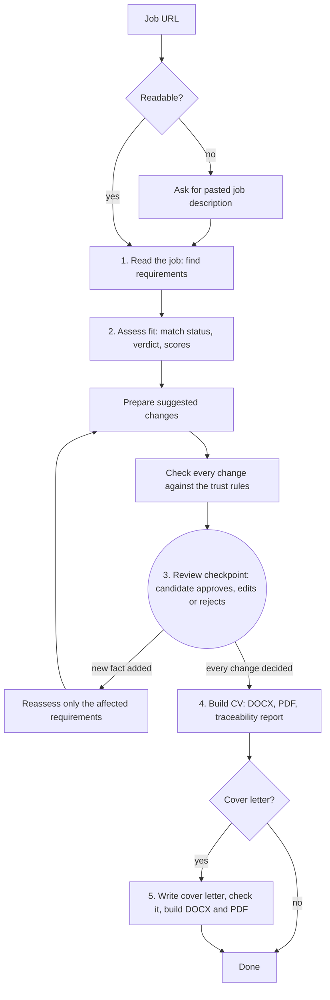

# Workflow

How a job moves through Litty, from the URL to the finished CV.

> **Status:** draft. The steps and the checkpoint are decided. Which steps use AI is not decided yet.

## Flow

## The checkpoint

Step 3 is where Litty waits for the candidate.

* Litty saves its progress before waiting.
* The candidate can leave and come back. Litty resumes from the same point.
* Nothing is built until every change has a decision.
* If building fails after approval, the decisions are kept.

## Partial reassessment

When the candidate adds a new fact during review, Litty reassesses only the requirements that fact affects. It does not reread the job or redo the whole assessment.

## Run record

Every run records the job text, the profile version, the evidence used, the changes and decisions, and the model and prompt versions. With it, any CV can be explained and reproduced.

## Open points

* Which steps need AI, and which are plain code? Record each choice in [decisions.md](decisions.md).
* What happens when a change fails the trust check several times in a row: drop it, or show it with a warning?
* Where is progress saved while Litty waits at the checkpoint?
