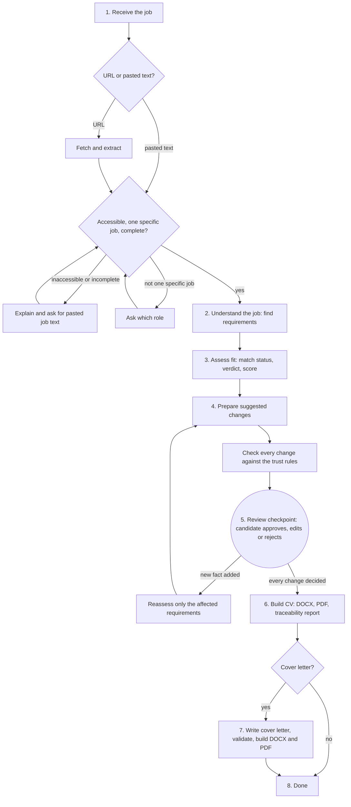

# Workflow

How a job moves through Litty, from the URL to the finished CV.

> **Status:** Draft. The steps and approval checkpoint are decided. Which steps use AI is not decided yet.

## Flow

1. **Receive the job**
    * Accept exactly one of a job URL or pasted job text.
    * If a URL is given, try to extract the job description.
    * If the URL is inaccessible, explain why and ask for pasted text.
    * If the page does not identify one specific job, ask which role the candidate wants.
    * Check that the job text (extracted or pasted) is complete. If not, explain what is missing and ask for the complete text.
    * The candidate can replace extracted text with pasted text. Before review, this invalidates the previous assessment and starts a new attempt.
    * Continue automatically only when the job text passes validation.
    * Never analyse the wrong or inaccessible page.
2. **Understand the job**
    * Extract the job requirements.
    * Classify each as `REQUIRED` or `DESIRABLE`.
3. **Assess fit**
    * Match requirements against candidate evidence.
    * Assign `MATCH`, `PARTIAL`, `MISSING` or `UNKNOWN`.
    * Produce a fit verdict and ATS alignment score.
4. **Prepare suggested changes**
    * Identify improvements to the master CV.
    * Link every suggestion to supporting evidence.
    * Check every suggestion against the trust rules.
5. **Review checkpoint**
    * Candidate approves, edits or rejects every suggestion.
    * Litty waits until every suggestion has a decision.
    * If a new fact is added, reassess only the affected requirements.
6. **Build the CV**
    * Generate DOCX and PDF.
    * Produce a traceability report.
    * Validate the generated documents.
7. **Cover letter**
    * Offer a cover letter once the CV is ready.
    * Generate and validate it only if requested.
8. **Done**

## Stages and Steps

The candidate sees five stages. The eight internal steps sit underneath them.

| Stage the candidate sees | Internal steps |
| --- | --- |
| 1. Read the job | 1. Receive the job, 2. Understand the job |
| 2. Assess fit | 3. Assess fit |
| 3. Review changes | 4. Prepare suggested changes, 5. Review checkpoint |
| 4. Build CV | 6. Build the CV |
| 5. Cover letter | 7. Cover letter |

Step 8 (Done) has no stage of its own.

## The Checkpoint

Step 5 is where Litty waits for the candidate.

* Litty saves its progress before waiting.
* The candidate can leave and return.
* Litty resumes from the same point.
* Nothing is built until every suggestion has a decision.
* If document generation fails, candidate decisions are preserved.

## Partial Reassessment

When the candidate adds a new fact during review, Litty reassesses only the requirements affected by that fact.

It does not reread the job description or repeat the entire assessment.

## Run Record

One conversation is one job run.

A run can have several attempts. Replacing the job text before review starts a new attempt in the same run. Every attempt is kept, and the last one is marked final.

Every run records:

* Final accepted job text and its source (URL or pasted).
* Profile version.
* Evidence used.
* Requirements and assessments.
* Suggested changes and candidate decisions.
* Validation results.
* Model, prompt and workflow/code versions.
* Generated document references.

This makes each CV explainable and allows the run to be reproduced as closely as possible.

## Open Points

1. Which steps use AI, and which use plain code? Record each choice in [decisions.md](decisions.md).
2. What happens when a change repeatedly fails trust validation?
3. Where is workflow progress persisted while Litty waits at the checkpoint?
